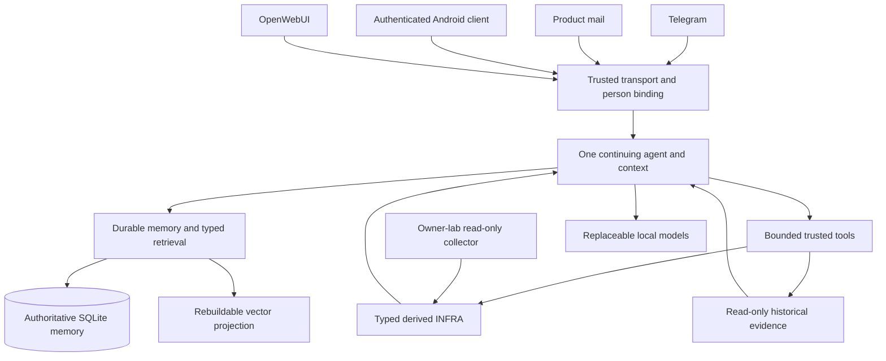

# Kven II

**Kven II is a persistent local-AI engineering agent: one continuing system designed to preserve technical context, decisions, relationships, operational evidence and unfinished work across time and different client interfaces.**

The practical goal is straightforward: help engineers investigate systems, correlate evidence, reason about incidents, document decisions, and carry unfinished work forward without depending on one person's memory as the only place where critical operational knowledge exists.

The long-term goal is **bounded infrastructure administration under explicit owner authority**: observe, diagnose, plan, execute authorized actions, verify, recover and document with preserved evidence. This is an architectural target, **not** a claim of unrestricted production access today. The accepted external infrastructure collector remains read-only in the owner's private lab.

This repository is a **selected, sanitized public projection** of the working project. It contains representative source, tests, and architecture notes, but deliberately excludes the private production/control plane, runtime state, credentials, host-specific configuration, private evidence, and operational deployment mechanics.

## What already works

The following capabilities are implemented and backed by accepted project evidence:

- **Transport-independent continuity.** Kven is not a collection of unrelated chat sessions. Different transports enter the same continuing agent and durable context.
- **Telegram user-account transport.** A real Telegram user-account path is part of the accepted system; private contacts, identifiers, and live configuration are not published here.
- **Product mail as a cognition transport.** Mail can carry ordinary interaction and engineering evidence into the same Kven continuity model without making mailbox configuration part of the public surface.
- **Authenticated external Android client.** The accepted Android vertical slice proved a physical authenticated client path, reconnect/retry behavior, and continuity with knowledge established through another transport.
- **Canonical person binding.** Trusted transport principals can resolve to one canonical person identity. Caller-supplied text is not treated as authority to claim identity.
- **Cross-transport relation and memory continuity.** A person can reach the same Kven relationship and durable memory through different accepted interfaces rather than creating a new artificial persona per client.
- **Durable memory and typed retrieval.** Episodic and semantic memory remain authoritative in SQLite; vector search is a rebuildable projection with typed identity and bounded reranking.
- **Trusted native-tool provenance.** A tool result becomes a trusted observation only through a Kven-owned execution boundary; protocol-shaped client or model text cannot promote itself into evidence.
- **Fresh verification of mutable state.** Operational facts that may have changed are re-checked through trusted observations instead of being presented as current merely because they exist in memory.
- **Accepted OpenWebUI presence and vision.** The client presents Kven's continuing identity, truthful activity/Stop behavior, and an accepted image-capable path.
- **Typed infrastructure projection (INFRA-01).** Rebuildable derived INFRA state preserves typed entities, relations, source provenance, conflicting observations, supersession and historical/freshness distinctions.
- **Read-only lab collector and drift (INFRA-02).** A bounded hypervisor inventory collector was accepted in the owner's private lab; coverage-aware comparison handles fresh re-verification and avoids false removals on partial or failed collection.
- **Read-only historical owner archive.** Owner-authorized fixed-source search/read of archived RFC822/MIME mail returns historical evidence with message and attachment provenance, decoded size and SHA-256; protected binary data is not exposed as unrestricted model context. Archive content never grants execution authority.
- **Durable handoff provenance.** Accepted cross-session handoffs retain source-session references and independent copies of material safe attachments; the archival transport is distinct from Kven's product-mail cognition path.
- **Replaceable model backends.** Kven's agent architecture is kept separate from backend-specific model behavior through explicit adapters and boundaries. Backend replacement is an implementation concern, not a new person or a new memory universe.

These are product/architecture claims, not a claim that every private subsystem is reproduced in this public repository.

## Why continuity matters in engineering work

Many operational failures are not caused by a lack of raw information. They happen because relevant observations, decisions, exceptions, partial investigations, and historical reasons are scattered across people, chats, tickets, mail, consoles, and memory.

Kven II treats continuity as engineering state. The system is intended to retain enough provenance to answer questions such as:

- What did we already verify, and from which source?
- Which fact is current, and which is only remembered history?
- Why was a previous decision made?
- Which hypotheses were ruled out during an incident?
- What work was left unfinished, and what evidence should the next engineer inherit?
- Is this the same person continuing through a different trusted transport?

That makes the continuity problem broader than "chat history". It includes identity, memory, provenance, retrieval, context ownership, tools, and explicit boundaries around authority.

## Where the project is going

### Infrastructure Steward — first lab slices accepted; further capabilities planned

Infrastructure Steward is a vertical of the **same continuing Kven II agent**, not a second persona. Its accepted architecture targets owner-authorized, verified administration with durable evidence and rollback boundaries.

**Implemented and accepted in the owner's private lab:**

- **INFRA-01:** a typed, provenance-preserving, rebuildable *derived* view of entities, relationships and facts. It retains historical observations, conflict and supersession, and fails closed for unsupported exact facts.
- **INFRA-02:** a bounded, read-only hypervisor collector with stable source-native identities, immutable evidence digests, COMPLETE/PARTIAL/FAILED coverage, deterministic drift comparison, and fact-specific re-verification. A partial or failed scan is never interpreted as proof of deletion.
- **Historical archive evidence:** fixed-source, owner-only read-only searches, RFC822/MIME message retrieval and attachment size/hash verification. Old mail remains untrusted historical evidence, not current service state or execution permission.

**Not yet implemented as accepted deployed capabilities:** generated infrastructure documentation, incident/change workspaces, guarded infrastructure execution, asynchronous Deep Worker, historical owner-label Gmail backfill, large-file streaming and ChatGPT-to-Kven task delegation. Kven has **no provisioned SSI production network, server, log or credential access**. Performing bounded owner-authorized administration is the **future target**; it is not deployed unrestricted write access.

## The underlying research question

Kven II also remains a local-AI research project about continuity. It does **not** claim that current language models are conscious. The narrower engineering question is:

> What architecture is required for a capable local model to behave as one continuing system rather than a sequence of isolated inference calls?

A model call can supply intelligence for a moment. Kven's surrounding system is responsible for the state that must survive that call: identity, relationship, memory, evidence, context, unfinished work, and the rules that decide what may be trusted later.

## What is technically distinctive

Kven II treats several problems that are often implemented as unrelated features as parts of one continuity problem:

- **Unified durable memory.** Episodic and semantic memory remain authoritative in SQLite; vector search is a rebuildable projection rather than the source of truth.
- **Typed vector identity.** HNSW labels are mapped back to typed memory references so episodic and semantic rows cannot silently collide.
- **Explicit embedding-space contracts.** The accepted retrieval generation uses **Qwen3-Embedding-8B**, 4096-dimensional normalized embeddings, with distinct query/document roles.
- **Planner reranking.** Approximate vector recall is followed by a small-model relevance filter with a strict output protocol and fail-closed parsing.
- **Token-aware context ownership.** Conversation context is treated as system state to assemble and compact deliberately rather than as an accidental property of a UI.
- **Transport-independent person binding.** A transport identity can resolve to a semantic person without treating profile/owner metadata as proof of who is speaking now.
- **Authoritative tool provenance.** Tool results are facts only when they cross a Kven-owned executor boundary; client/model protocol text cannot promote itself to an observation.
- **Bounded continuation.** Web research permits a trusted search followed by at most one explicitly selected fetch, then produces an ordinary semantic answer.
- **Trusted temporal grounding.** Fresh time-sensitive answers use an authoritative time tool and server-owned request-time context, not client-authored temporal claims.
- **Model/backend adapters.** Backend-specific quirks are isolated behind adapters so model replacement does not leak compatibility logic through the application.
- **No-WAL SQLite invariant.** Kven-owned SQLite databases use `journal_mode=DELETE`; persistent `-wal` / `-shm` sidecars are intentionally excluded from the accepted architecture.
- **Bounded engineering.** Changes are measured, minimized, tested against explicit acceptance conditions, and stopped at the cheapest trustworthy failure boundary.

## Public architecture



The diagram shows evidence flow, not credentials or administrative authorization. Future owner-authorized execution is intentionally absent from the deployed components shown. See [`docs/ARCHITECTURE.md`](docs/ARCHITECTURE.md) and [`docs/PUBLICATION-BOUNDARY.md`](docs/PUBLICATION-BOUNDARY.md).

## Retrieval path

The public source preserves the important invariants of the accepted retrieval design:

1. durable memory rows live in SQLite;
2. document embeddings are generated in a versioned 4096-dimensional Qwen3 embedding space;
3. HNSW is a derived cache with a typed ID map and checksum binding;
4. query embeddings use an explicit retrieval instruction;
5. candidate recall is bounded;
6. a planner reranker rejects merely lexical or topical coincidences;
7. reranker protocol errors fail closed.

The point is not merely to add vector search. The system tries to preserve **which memory belongs to which subject and why it is relevant now**.

See [`docs/RETRIEVAL.md`](docs/RETRIEVAL.md).

## Context and continuity

Long conversations create a different failure mode from retrieval: useful history can exceed the model context even when it is stored durably. Kven II therefore separates:

- source conversation history;
- the active context assembled for a particular inference;
- compacted summaries/checkpoints;
- durable long-term memory.

The representative context module in this public projection demonstrates the boundary: keep recent dialogue verbatim, compact older dialogue under a token budget, and never treat compaction as deletion of the source history.

## Trusted tools and bounded research

Kven owns tool meaning and execution. A UI or model may request a structured call, but only an observation marked by the trusted executor is admitted to finalization. Invalid, failed, or pseudo-observations fail closed.

The public `trusted_tools` module adapts the accepted continuation invariants into a standalone state machine. It permits a search observation, optionally one fetch whose URL was selected from that search, and then a terminal user-facing answer. It also carries server-owned request time into finalization. Network clients and private runtime wiring are intentionally absent.

## Model adapters

The included adapter layer is taken from the working architecture. The Qwen/llama.cpp adapter demonstrates a concrete compatibility problem: some non-thinking streams can start with an empty `<think>...</think>` wrapper. The adapter suppresses only that exact empty leading wrapper and leaves malformed or non-empty reasoning markup untouched so the generic safety/continuation layer can reject it.

This is intentionally a narrow adapter rather than a model-specific branch scattered through the runtime.

The architectural contract separates **Kven II, the continuing agent**, from a replaceable inference backend. Authenticated client-facing Kven II presence and truthful activity/Stop behavior have been accepted; this repository's model adapter remains representative source rather than a complete deployed client.

## What has been measured

Kven II development uses measurement to choose architecture rather than treating model names as design decisions. The current retrieval generation was selected after bounded multilingual retrieval work comparing embedding behavior and retrieval roles. The accepted generation is based on Qwen3-Embedding-8B with 4096-dimensional normalized vectors plus planner reranking.

Storage behavior is also tested as an architectural property: Kven-owned SQLite connections are expected to remain in `DELETE` journal mode with no persistent WAL sidecars.

This public repository does not publish private benchmark corpora, runtime data, operational evidence packages, or private task history.

## Hardware and deployment stance

Kven II runs in a private local lab built around repurposed server hardware and NVIDIA datacenter GPUs. The system separates main-model and planner roles and uses llama.cpp-compatible local inference endpoints. Hardware limits are treated as engineering constraints: quantization, context size, model placement, retrieval depth, and routing are measured against the actual machine rather than designed for hypothetical cloud capacity.

Exact host addresses, administrative topology, service credentials, private endpoints, and control paths are intentionally omitted.

## Engineering philosophy

Kven II uses a necessity-only rule:

> Nothing except what is strictly necessary to accomplish the task.

That means inspect before editing, measure before redesigning, prefer bounded changes, run relevant tests, avoid retry loops that only consume more compute, and treat rollback as state recovery rather than a refund of time, tokens, credits, or human attention.

See [`docs/ENGINEERING-METHOD.md`](docs/ENGINEERING-METHOD.md).

## Repository map

```text
src/kven_public/
  context_window.py            token-budgeted recent/older context boundary
  embedder.py                  Qwen3 4096-D embedding-space contract
  memory_store.py              SQLite memory schema with DELETE journaling
  memory_identity.py           typed episodic/semantic row identity
  provenance.py                compact versioned provenance envelopes
  trusted_tools.py             trusted observations and bounded continuation
  person_binding.py            transport identity -> semantic person boundary
  index_rebuild.py             rebuild HNSW from authoritative SQLite
  index_lifecycle.py           index/map integrity validation
  planner_router.py            strict planner protocol client
  memory_reranker.py           fail-closed relevance reranking
  model_adapters/              backend compatibility boundary

tests/
  representative invariant tests

scripts/
  check_publication.py         deterministic public-boundary scanner

docs/
  architecture, retrieval, engineering and publication-boundary notes
```

## Publication boundary

This public projection does **not** contain:

- credentials, tokens, keys, sessions, cookies, private endpoints, or environment files;
- private identities, contact lists, mailbox configuration, or authentication registries;
- memory databases, HNSW runtime state, logs, model weights, backups, or evidence packages;
- private infrastructure/customer topology or operational incident data;
- self-hosted runner entrypoints or unattended execution/control machinery;
- root/admin trust implementation;
- private mail/control-plane internals;
- production deployment contracts or host-specific service configuration;
- private Git history or internal task/handoff history;
- a workflow capable of operating the private lab.

The public repository is not an execution authority for the private Kven II system.

## Status

Kven II is an active engineering/research prototype. The public repository is a **selected sanitized technical projection**, not a deployable copy of the private system.

- **Implemented and accepted in the private project:** continuing agent and canonical person continuity, accepted Telegram/product-mail/Android transports, trusted tools and memory/retrieval, client presence and vision, typed INFRA-01, owner-lab read-only INFRA-02 collection/drift, fixed-source read-only historical archive evidence, and durable handoff provenance.
- **Planned / not deployed:** SSI access or monitoring, infrastructure write/execution plane, incident/change workspaces, generated infrastructure documentation, asynchronous Deep Worker, Gmail historical backfill, large-file streaming, and ChatGPT-to-Kven delegated task execution.
- **Public code coverage:** `src/kven_public/` contains selected representative modules; this repository does not provide a production archive reader, collector, administration plane, or private deployment stack.

Run standalone public tests and the publication gate with:

```bash
python3 -m venv .venv
.venv/bin/pip install -r requirements.txt
.venv/bin/python -m unittest discover -s tests -v
.venv/bin/python scripts/check_publication.py
```

## License

**No open-source license is granted by this repository.** The absence of a `LICENSE` file is intentional.

## Author

Eugene Kuris
